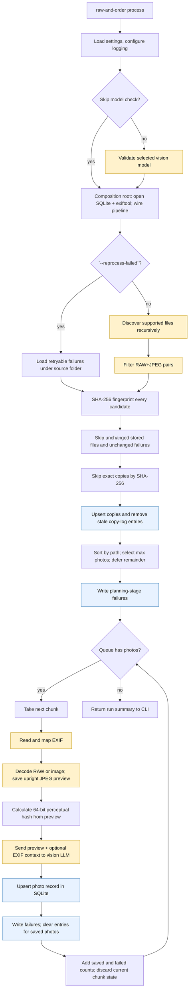
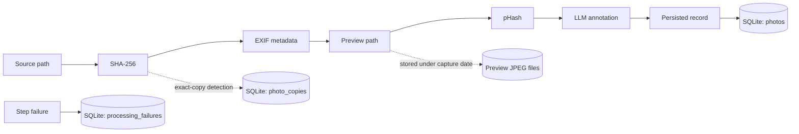
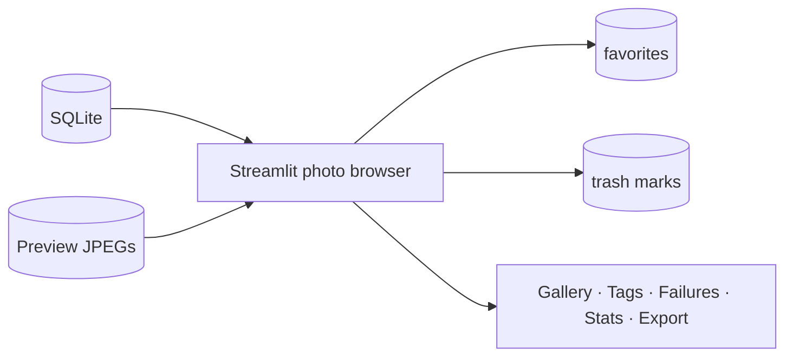

# Raw and Order workflow

This diagram reflects the implementation, primarily the fixed step sequence in
[`workflow/runner.py`](../src/raw_and_order/workflow/runner.py), rather than
only the user-facing command description.

## What moves through the pipeline

`WorkflowState` holds both run settings and the mutable work lists. A
`PhotoItem` gains data in this order:

The preview is the shared asset: it is saved during decoding, then both the
pHash step and the LLM read it. The Streamlit UI later reads the photo rows and
previews, derives thumbnails from previews, and writes only favorite/deletion
marks.

## Processing and failure behaviour

| Situation | Behaviour |
| --- | --- |
| A single file fails fingerprinting, EXIF extraction, decoding, pHash, annotation, or persistence | The item receives a structured error, later per-item steps skip it, and it is recorded in `processing_failures`; other files continue. |
| Every file in a chunk has already failed | The remaining transformation steps are skipped; the chunk goes straight to failure-log sync and tallying. |
| LLM outage or configured consecutive annotation-failure limit | The entire run aborts. Earlier completed chunks remain committed; the interrupted chunk is neither persisted nor added to the failure log. |
| Restart after interruption | A normal process run skips unchanged persisted photos and resumes the remaining work; `--reprocess-failed` starts from the failure log only. |
| Exact byte-for-byte copy | The duplicate is not annotated or stored as a photo. It is recorded in `photo_copies` with an original path. |

## Other command paths

- `raw-and-order process --reread-exif` uses the database and exiftool, then
  updates only stored EXIF columns. It bypasses decoding, previews, hashing,
  and the LLM.
- `raw-and-order rehash` uses the database and existing previews to replace
  pHashes. It needs neither exiftool nor an LLM.
- `raw-and-order ui` runs the Streamlit browser against the SQLite catalogue
  and saved previews; it does not run photo processing.

## Code map

- CLI and command branching: [`main.py`](../src/raw_and_order/main.py)
- Dependency wiring and resource lifetimes: [`bootstrap.py`](../src/raw_and_order/bootstrap.py)
- Run entry point and summary: [`pipeline.py`](../src/raw_and_order/pipeline.py)
- Fixed workflow loop and abort policy: [`workflow/runner.py`](../src/raw_and_order/workflow/runner.py)
- State and per-photo data contract: [`workflow/state.py`](../src/raw_and_order/workflow/state.py)
- Individual steps: [`workflow/steps/`](../src/raw_and_order/workflow/steps/)
- SQLite models and repositories: [`db/`](../src/raw_and_order/db/)
- File discovery, EXIF, decoding, previews, and hashes: [`media/`](../src/raw_and_order/media/)
- Model integration and structured annotation: [`llm/`](../src/raw_and_order/llm/)
- Streamlit browser: [`ui/`](../src/raw_and_order/ui/)
